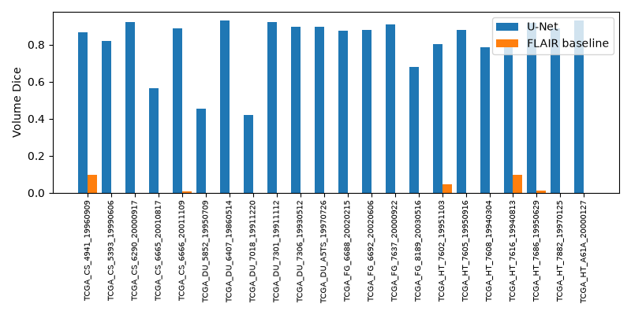

# Brain tumor segmentation

A ResNet34 U-Net segments lower-grade gliomas in MRI. Patient-level training, validation, and held-out test sets support volume-level Dice evaluation against a FLAIR threshold baseline.

## Repository layout

```text
src/          Data loading, model, training, inference and analysis
scripts/      Experiments, verification, smoke tests and report export
notebooks/    Five ordered notebooks; saved outputs are cleared
reports/      Curated verified tables, reports and aggregate figures
docs/        Repository structure and publishing guidance
data/        Local MRI data (ignored; instructions tracked)
checkpoints/ Local model weights (ignored; instructions tracked)
outputs/     Generated runs, caches and executed notebooks (ignored)
```

See [the project structure](docs/PROJECT_STRUCTURE.md), [results index](reports/README.md), and [contribution guide](CONTRIBUTING.md). The GitHub repository contains source and recorded evidence, not MRI scans or model binaries. A fresh clone can run synthetic smoke tests; the demo requires local data and trained weights. Existing published results describe the documented original checkpoint, not an arbitrary retraining run.

## Dataset card

The [LGG MRI Segmentation dataset](https://www.kaggle.com/datasets/mateuszbuda/lgg-mri-segmentation) by Mateusz Buda contains 110 patients and approximately 3,900 axial 256 × 256 slices. Each TIFF contains pre-contrast, FLAIR, and post-contrast channels in that order. Binary masks annotate FLAIR abnormality. Missing pre-contrast or post-contrast sequences can be represented by FLAIR copies in those channels. Roughly one third of slices contain tumor. FLAIR is channel 1. The data derives from TCGA lower-grade glioma scans, and the benchmark reference mean Dice is approximately 0.82 with patient-level splits. See the dataset page for provenance, usage terms, and the associated Buda et al. publication. This project supports research and learning.

Place data in `data/kaggle_3m/<patient>/`. Follow [download instructions](scripts/download_data.md). The project never downloads MRI data automatically.

## Local setup

Use Python 3.10+ and the VS Code Python and Jupyter extensions. Run from the repository root.

```powershell
python -m venv .venv
.venv\Scripts\Activate.ps1
pip install torch torchvision --index-url https://download.pytorch.org/whl/cu124
pip install -r requirements.txt
python -m ipykernel install --user --name lgg-mri --display-name "LGG MRI"
python scripts/smoke_test.py
```

The smoke test uses eight patients and four numerically ordered slices per patient, one epoch, and randomly initialized ResNet34 weights to avoid an external weights download. It isolates all outputs under `outputs/smoke/` and `checkpoints/smoke/`. When data is absent, it generates synthetic scans in a temporary directory. Force that path with `python scripts/smoke_test.py --synthetic`. Synthetic checkpoints retain temporary scan provenance and serve as smoke-test artifacts. GPU execution must finish within 120 seconds or the command exits non-zero. CPU fallback prints a warning and can take longer. Dependency installation is performed before timing the pipeline.

## Kaggle and Colab

Upload or clone this repository. In Kaggle enable a GPU and attach the LGG dataset. In Colab select a GPU runtime, upload/extract the dataset to `data/kaggle_3m` under the cloned repository or mount Drive and link that directory. Change the notebook working directory to the repository root and install requirements with `%pip install -r requirements.txt`. Hosted environments normally provide PyTorch, and `python -c "import torch; print(torch.cuda.is_available())"` verifies GPU access. Enable internet for the first full training run so SMP can fetch ImageNet encoder weights. Use the same notebook and module entry points in each environment.

## Run in order

Choose the project kernel in VS Code. Open each notebook and Run All in numerical order.

1. `notebooks/01_explore.ipynb` shows MRI channels and masks and creates the fixed patient split and statistics cache.
2. `notebooks/02_baseline.ipynb` evaluates the raw FLAIR baseline on held-out patients.
3. `notebooks/03_train.ipynb` trains and saves the best validation-volume-Dice checkpoint.
4. `notebooks/04_evaluate.ipynb` reports test metrics and plots and writes a demo overlay.
5. `notebooks/05_failures.ipynb` shows worst slices for the five worst patients, volume Dice by tumor size, and Dice near scan boundaries.

Equivalent commands are

```bash
python -m src.baseline
python -m src.train
python -m src.evaluate
python -m src.app
```

Configure `BATCH_SIZE=8`, `ENCODER="resnet34"`, `EPOCHS=30`, `NUM_WORKERS=2`, and `SMOKE_TEST=False` in `src/config.py`. Full training uses ImageNet initialization, AdamW encoder/decoder learning rates of 1e-4/1e-3, Dice+BCE loss, and plateau scheduling. CUDA uses autocast and gradient scaling. For memory errors reduce the batch size or use resnet18. Setting `SMOKE_TEST=True` restricts the standard pipeline to eight patients and at most two epochs and automatically selects smoke artifact directories. The standalone smoke script uses one epoch and disables pretrained downloads.

## Evaluation and leakage prevention

`GroupShuffleSplit(random_state=42)` holds out 20% of patients, then reserves 15% of the remaining patients for validation. All slices of each patient stay together. `outputs/split.json` is reused and checked for disjoint patient IDs. Per-patient channel mean and standard deviation are cached from each available scan. Test normalization uses only that patient's unlabeled intensities. Validation and test volume counts aggregate all slices before computing Dice. Training checkpoint selection uses threshold 0.5. Default evaluation and demo inference use the checkpoint-bound setting in `checkpoints/inference.json`, currently 0.70. Empty truth and prediction volumes score 1. False alarms count tumor-free slices with any predicted tumor pixel.

The pipeline warns if held-out mean Dice exceeds 0.90. Common mistakes addressed here include random slice splits, per-slice Dice averaging, mismatched image/mask sorting, and bilinear mask resizing. Mask paths drive pairing and slice indices sort numerically. Training transforms share geometry with nearest-neighbor mask interpolation and binary-mask assertions.

Outputs include `baseline_dice.csv`, `per_patient_dice.csv`, `metrics.json`, `history.csv`, normalization statistics, split metadata, and PNG plots. `checkpoints/best.pt` embeds model architecture, patient split, normalization, and validation score. Evaluation verifies this provenance. Preserve these files together when moving experiments.

## Reported test-patient results

Completed a 30-epoch ImageNet-initialized ResNet34 run with seed 42, using 74 training, 14 validation, and 22 held-out test patients. The selected checkpoint is from epoch 21, with mean validation volume Dice of 0.8660 at threshold 0.5. Subsequent validation-only threshold selection chose 0.70, with mean validation Dice of 0.8677.

The shipped model is the original `checkpoints/best.pt`, trained before the worker-specific augmentation-seeding correction. Its SHA-256 is `fda957e3a3cb4b78419099ef9987885648fc35176c59e0dd61bde3873610c247`. The demo shows this model ID, epoch 21, and threshold 0.70. `outputs/deployment_manifest.json` and `outputs/metrics.json` record the same identity. The six newer corrected-seeding checkpoints were compared on validation patients.

| Model | Mean patient volume Dice | Median patient volume Dice |
|---|---|---|
| Prescribed raw FLAIR 3-sigma baseline | 0.0117 | 0.0000 |
| FLAIR threshold (tuned on development patients) | 0.3134 | 0.2923 |
| U-Net, reference threshold 0.50 | 0.8129 | 0.8772 |
| U-Net, selected threshold 0.70 | 0.8139 | 0.8778 |

At threshold 0.70, the U-Net produced false alarms on 18 of 483 tumor-free test slices, a false-alarm rate of 3.73%. At threshold 0.50 these values were 19/483 and 3.93%. These results use complete held-out patient volumes. Exact current metrics are in `outputs/metrics.json`, and individual patient scores are in `outputs/per_patient_dice.csv`. Reference outputs at threshold 0.50 are archived in `outputs/reference_threshold_0_5/`. Tracked notebooks omit saved outputs; executed copies remain local under `outputs/notebook_archive/`, and the published results are indexed in `reports/README.md`.

For the same 22 test patients at threshold 0.70, mean patient precision is 83.35% and mean patient recall is 82.98%. Pooled pixel precision is 84.46% and pooled recall is 78.51%. Total errors are 87,722 false-positive pixels and 130,502 false-negative pixels. The model predicts zero tumor pixels on 20 of 295 annotated slices; the zero-overlap positive-slice count is also 20. Of the false-positive pixels, 10,678 occur on tumor-free slices and 77,044 on annotated slices. These are pixel counts across slices, with physical volumes requiring spacing metadata.

The [verification report](reports/publication_checks/report.md) documents checkpoint identity, per-seed evidence, baseline verification, and controller recovery. `outputs/per_slice_errors.csv` contains slice-level diagnostics, and `outputs/per_institution_metrics.csv` contains the source-institution breakdown with group sizes. The institution groups contain only 4-7 test patients each and provide descriptive comparisons. The extra measurements describe the already selected checkpoint and threshold on previously inspected test cases.

The baseline was independently reproduced with Pillow TIFF loading, float64 threshold arithmetic, and direct volume-level TP/FP/FN counts, with zero prediction mismatches on all 778 test slices. Fifteen patients have zero baseline overlap with the annotations, and its pooled annotated-pixel recall is 0.56%. The very low score is a measured failure of the specified raw per-slice mean-plus-three-standard-deviations rule. Prior near-zero values around 1e-12 came from numerator epsilon smoothing. Zero-overlap, nonempty volumes now report exact zero, and two empty volumes score one. The baseline mean rounds to the same 0.0117. Independent counts and comparison images are saved in `outputs/publication_checks/`.

The separate tuned FLAIR comparator searches the specified 440 combinations of patient-pooled intensity threshold, brain-mask erosion, minimum slice-component area, and optional largest 3D component using only the 74 training and 14 validation patients, maximizing mean patient-volume Dice. Its configuration is frozen before opening test files, and the fixed baseline is evaluated once on the 22 test patients with the U-Net's file lists, numeric ordering, Dice function, and false-alarm definition. This is a descriptive comparison on one split of 22 previously inspected patients; the U-Net's margin over this baseline is not a general result.

Run `python -m src.baseline_tuned` or the added section of `notebooks/02_baseline.ipynb`; completed runs reuse saved results. The full grid, frozen configuration, development metrics, test metrics, per-patient comparison, file-list assertions, and two comparison figures are saved under `outputs/baseline_tuned*`, with a separate `baseline_tuned` section in `outputs/metrics.json`. Run the isolated classical smoke test with `python scripts/smoke_test_baseline_tuned.py --synthetic`; it checks all 440 settings on synthetic development scans and verifies morphology against a direct SciPy implementation without modifying shipped artifacts.

Selected tuned-baseline setting: `k=1.0`, `E=9`, `min_area=200`, `largest_3d=False`. Development mean/median Dice: 0.3282/0.3317; test false alarms: 339/483, pooled precision/recall: 23.29%/46.46%, zero-prediction annotated slices: 29/295, zero-overlap patients: 1/22. See [the tuned-baseline report](reports/baseline_tuned_report.md) for development and test errors.

## Threshold selection

The [threshold report](reports/experiments/threshold_sweep/report.md) compares thresholds 0.20 through 0.70 in steps of 0.05 on the 14 validation patients. The selected threshold maximizes mean patient-volume Dice, with ties favoring the value closest to 0.5. The best tested threshold was the upper grid boundary, 0.70. Mean validation patient recall decreased from 90.00% to 89.23%, and validation false alarms were 5/269 at both thresholds. The mean Dice gain is small and its exploratory bootstrap interval includes zero. The later test-score change is exploratory because these test patients were inspected during diagnosis. Additional independent patients are needed to establish generalization.

`python scripts/select_threshold.py --apply` repeats selection and writes checkpoint-bound inference metadata. An explicit `Config(prediction_threshold=0.5)` reproduces reference inference. The trained weights are identified by SHA-256 in the threshold report and `checkpoints/inference.json`. Model loading falls back to threshold 0.5 with a warning if calibration metadata refers to different weights.

## Positive-sampling experiment

A controlled 30-epoch experiment targeted 50% tumor-containing training slices using weighted sampling with replacement, compared with the original 33.43%. Each epoch retained 2,710 training draws, with seed 42 and the original split and training settings. The selected candidate checkpoint is from epoch 8.

On the 14 validation patients, mean Dice was 0.8624 for the candidate and 0.8660 for the reference. Mean patient tumor recall was 84.63% versus 90.00%, and false alarms were 6/269 versus 5/269. Dice improved for ten patients and worsened for four, with two substantial regressions. This run favors the reference checkpoint. The paired mean-Dice difference interval includes zero, and a single seed provides limited evidence about generalization.

The [experiment report](reports/experiments/positive_sampling/report.md) contains per-patient results and comparison images. The experiment checkpoint is `checkpoints/experiments/positive_sampling/best.pt`. `python scripts/positive_sampling_experiment.py` starts the initial experiment, and `python scripts/positive_sampling_experiment.py --compare-only` regenerates its validation comparison from saved checkpoints. Training refuses to overwrite an existing experiment history. The sampler is available through `Config(target_positive_fraction=0.5)` with dedicated output and checkpoint paths.

## Worker seeding and normalization study

Training now initializes each data-loading worker's augmentation RNG from its reproducible Torch worker seed. Persistent training workers continue their streams across epochs. Validation uses the main process to reduce RAM use. Actual two-worker, two-epoch checks verified reproducibility, differing worker/epoch streams, binary masks, and aligned image/mask geometry.

Six matched 30-epoch runs compared `whole_volume` and `foreground_nonzero` scan normalization using seeds 42, 43, and 44. Both conditions used corrected seeding, the same patient split, and the original architecture, loss, optimizer, natural sampling, and training budget. At the fixed comparison threshold 0.70, whole-volume normalization averaged validation Dice 0.8641 and mean patient recall 86.88%. Nonzero-foreground normalization averaged Dice 0.8337 and recall 80.38%. Whole-volume normalization is recommended for this project.

| Seed | Whole-volume validation Dice | Foreground validation Dice |
|---|---:|---:|
| 42 | 0.8717 | 0.8290 |
| 43 | 0.8588 | 0.8439 |
| 44 | 0.8619 | 0.8283 |

These comparisons use the same 14 validation patients. The 22-patient test table above measures a different cohort and the original shipped checkpoint. The study's exploratory uncertainty interval includes zero, and independent-patient generalization remains unmeasured.

The progress controller failed during `whole_volume_seed43` because a Windows reader temporarily locked the status file during replacement. That training process continued through all 30 epochs. The recovered controller verified the first two completed jobs, registered the completed third job, and started `foreground_nonzero_seed43`. All six training jobs completed on attempt 1 with complete epoch histories and verified checkpoint hashes. Status writes now retry transient locks.

The [six-run report](reports/experiments/normalization_multiseed/report.md) contains uncertainty estimates, patient-level comparisons, scan diagnostics, and same-slice images. These are validation results on the same 14 patients across three seeds. The study evaluated zero test-patient predictions. It isolates the normalization comparison under corrected seeding, while the effect of the seeding correction itself remains unmeasured across matched old-seeding runs.

Run `python scripts/verify_preprocessing.py` for the focused preprocessing checks. Run `python scripts/normalization_experiment.py` to verify completed jobs and continue the experiment queue, or `python scripts/normalization_experiment.py --compare-only` to regenerate the comparison. An interrupted training job starts fresh in a separate attempt directory. Its partial artifacts are retained. `Config(normalization_mode="foreground_nonzero")` enables the optional foreground method with its own output and checkpoint paths. Cached statistics record the method, and inference restores it from checkpoint metadata. Foreground normalization uses nonzero image pixels and includes head tissues outside the brain.

## Demo screenshot

The aggregate patient-volume Dice plot below summarizes the held-out cohort. MRI overlays remain local under `outputs/`; the GitHub snapshot contains aggregate plots and result tables.



Launch `python -m src.app`, upload a TIFF/PNG/JPG, and choose the matching patient normalization profile. Preserve the three MRI channel values when converting to PNG/JPG. For a new patient, compute statistics from their complete scan with `patient_statistics` and add the profile to the checkpoint metadata before using the demo. This preserves scan-level normalization for a single-slice upload. The interface returns the overlay and tumor area in pixels.

<!-- recall-optimization:start -->
## Recall optimization experiments

Two validation-only experiments tested seeded probability-region growth and a recall-weighted Tversky+BCE objective. The growth candidate recovers an average 1.39 recall points across three corrected-seeding models, but loses precision and fails the same Dice-loss tolerance on the shipped model; it is not enabled. The staged 30-epoch loss experiment completed 1 seed(s): no candidate met the staged confirmation requirements; retain shipped model.

The shipped checkpoint, demo, 0.70 threshold and all original numbers remain unchanged. See the [combined optimization report](reports/experiments/recall_optimization_report.md) for matched validation metrics, failure diagnostics, acceptance rules and remaining gaps. New test inference was not run; independent patient validation remains outstanding. Default training still uses Dice+BCE; `Config(loss_name="tversky_bce")` opts into the experimental objective and should use separate output and checkpoint directories. Run `python scripts/smoke_test_recall.py` for the isolated synthetic training and refinement checks.

A separate small-component cleanup follow-up also failed its fixed acceptance screen. Its highest-Dice setting reached 0.8775 validation Dice with 2/269 false alarms and 9 missed slices, but did not meet the recall/precision limits. These are partial development gains, not new test scores or an accepted deployment.
<!-- recall-optimization:end -->

## Refresh published evidence

Run `python scripts/export_reports.py` after verifying a completed experiment. This refreshes `reports/` without changing the original local results or running inference. Keep notebook outputs cleared before committing; executed notebook backups stay under ignored `outputs/notebook_archive/`. See [GitHub preparation](docs/PROJECT_STRUCTURE.md#github-preparation) before staging files: this project was found inside an ancestor Git repository rooted at `C:/`.
