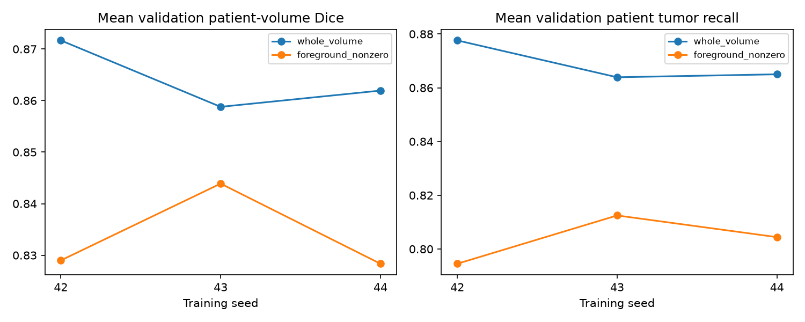

# Worker seeding and normalization experiment

Six matched 30-epoch runs compare whole-volume normalization with per-channel, per-patient nonzero-foreground normalization. Both conditions use corrected worker-specific augmentation seeds and persistent training workers. Exactly zero-valued pixels are excluded from foreground statistics and remain zero after normalization. The foreground is image-derived and includes non-brain head tissues; it is not a brain-extraction mask.

Seeds are 42, 43, and 44. Each run uses ImageNet-initialized ResNet34, batch size 8, natural slice sampling, the original Dice+BCE loss and optimizer/scheduler settings, 74 training patients, and the same 14 validation patients. Training checkpoint selection uses volume Dice at threshold 0.5. The prespecified primary comparison uses threshold 0.7 for both conditions. Secondary threshold-0.5 results are in `run_summary.csv`.

## Matched-seed validation results

| Method | Seed | Mean volume Dice | Median volume Dice | Mean patient recall | False alarms | Completely missed positive slices |
|---|---:|---:|---:|---:|---:|---:|
| foreground_nonzero | 42 | 0.8290 | 0.8753 | 79.45% | 7/269 | 9 |
| foreground_nonzero | 43 | 0.8439 | 0.8803 | 81.25% | 5/269 | 12 |
| foreground_nonzero | 44 | 0.8283 | 0.8804 | 80.44% | 3/269 | 11 |
| whole_volume | 42 | 0.8717 | 0.8940 | 87.76% | 2/269 | 10 |
| whole_volume | 43 | 0.8588 | 0.8804 | 86.39% | 10/269 | 8 |
| whole_volume | 44 | 0.8619 | 0.8791 | 86.50% | 4/269 | 10 |

## Across-seed comparison

Foreground normalization changes mean Dice by -0.0304, averaged across matched seeds and patients. The exploratory crossed seed/patient bootstrap 95% interval is [-0.0863, +0.0041]. It resamples seed pairs and patient identities jointly across both methods, using 10,000 replicates and seed 42. The interval has limited precision with three seeds and omits checkpoint-selection uncertainty. Validation patients have been reused during earlier development, so this study cannot establish independent generalization.

Average Dice improves for 7 validation patients and worsens for 7.

## Recommendation

These results do not demonstrate consistent improvement across Dice, recall, and false alarms. Use the established deployed reference while interpreting the measured tradeoffs. The corrected worker-seeding implementation is available for subsequent training, and each new checkpoint records its normalization and seeding settings.

## Same-slice spatial comparisons

These examples use the same slice for both seed-42 models. Patients have the lowest and highest average Dice changes across seeds. Green indicates overlap, red excess prediction, and blue missed annotation.

### TCGA_CS_5396_20010302

*MRI illustration retained in the local generated report.*

*MRI illustration retained in the local generated report.*

### TCGA_HT_7884_19980913

*MRI illustration retained in the local generated report.*

*MRI illustration retained in the local generated report.*

## Preprocessing evidence and limitations

`preprocessing_checks.json` records actual two-worker, two-epoch reproducibility checks, worker/epoch stream diversity, binary-mask geometry checks, background handling, blank-channel support, cache invalidation, and legacy normalization equivalence. `scan_diagnostics.csv` contains institution codes, duplicated-channel flags, foreground fractions, and both sets of scan statistics. Duplicated channels may reflect documented replacement of missing sequences with FLAIR. Source documentation defines the target as FLAIR abnormality. Annotation consistency and anatomical correctness require source-data or expert review.

*MRI illustration retained in the local generated report.*

Per-patient measurements, completely missed positive-slice counts, and false-positive/negative pixel counts are in `validation_patient_metrics.csv`. The test set contributes zero label or prediction measurements to this experiment. Its unlabeled scan intensities appear in cached per-patient statistics, as in the existing pipeline. The original test cases were inspected previously, so an additional independent dataset is needed for final confirmation.

## Runtime and reproducibility

`protocol.json` records software, source fingerprints, original checkpoint identity, fixed settings, and selection rules. `jobs.json` identifies all six completed checkpoints. Each job has `history.csv`, `completed.json`, normalization metadata, and a log. Running this script again verifies completed job identities and continues the unfinished queue. Interrupted jobs start fresh in a separate attempt directory, retaining their partial artifacts.

The six runs used 1.92 hours of cumulative training time. A transient Windows file lock interrupted the progress controller while one worker continued training. The controller was recovered after that job completed. All six runs completed on their first training attempt, and checkpoint identities were verified. Status replacement now retries transient locks. A focused regression check verified recovery from a simulated lock.

## Scope of the seeding result

The corrected worker seeding was checked for reproducibility and worker/epoch diversity. Both normalization conditions use that correction. This comparison isolates normalization under corrected seeding. It does not isolate the accuracy effect of seeding versus the older implementation because matched three-seed old-seeding controls were outside the six-run protocol.

## Compatibility verification

The synthetic end-to-end GPU smoke pipeline passed in 10.7 seconds. All six checkpoints have verified hashes, matching seed and normalization metadata, and complete 30-epoch histories. Every comparison observation belongs to one of the 14 validation patients. The source fingerprints match the training protocol. The original checkpoint and threshold metadata identities were verified. Detailed checks are saved in `integrity_checks.json`.

The real-data end-to-end GPU smoke pipeline also passed in 9.6 seconds. Single-slice callbacks were verified for both a foreground-normalized checkpoint and the existing whole-volume model. Checkpoint loading restored foreground normalization automatically, and the deployed model loaded threshold 0.70. The production metric record matches the pre-study snapshot.

## Deployment and recovery clarification

The shipped model is the original epoch-21 pre-worker-fix checkpoint at threshold 0.70, identified by `fda957e3a3cb4b78419099ef9987885648fc35176c59e0dd61bde3873610c247`. This study compares corrected-seeding runs on 14 validation patients. The deployed model test scores describe 22 different patients.

The progress controller failed while `whole_volume_seed43` continued training, after a Windows status-file rename lock. The training process finished all 30 epochs. The recovered controller verified the first two jobs and registered the completed third job before starting `foreground_nonzero_seed43`. Every training job completed on attempt 1. The full verification report is `../../publication_checks/report.md`.

## Institution-level validation breakdown

`per_institution_metrics.csv` contains each seed and threshold separately. `per_institution_seed_summary.csv` averages the three primary-threshold seed summaries for each normalization method and institution. Patient counts refer to the same validation patients per seed. The FG validation group contains only one patient, which limits interpretation.

| Normalization | Institution | Patients per seed | Seeds | Mean patient Dice | Mean patient recall |
|---|---|---:|---:|---:|---:|
| foreground_nonzero | CS | 3 | 3 | 0.7299 | 64.40% |
| foreground_nonzero | DU | 4 | 3 | 0.8768 | 87.77% |
| foreground_nonzero | FG | 1 | 3 | 0.8144 | 72.78% |
| foreground_nonzero | HT | 6 | 3 | 0.8602 | 84.71% |
| whole_volume | CS | 3 | 3 | 0.8440 | 79.58% |
| whole_volume | DU | 4 | 3 | 0.8666 | 90.58% |
| whole_volume | FG | 1 | 3 | 0.8727 | 84.11% |
| whole_volume | HT | 6 | 3 | 0.8711 | 88.53% |
