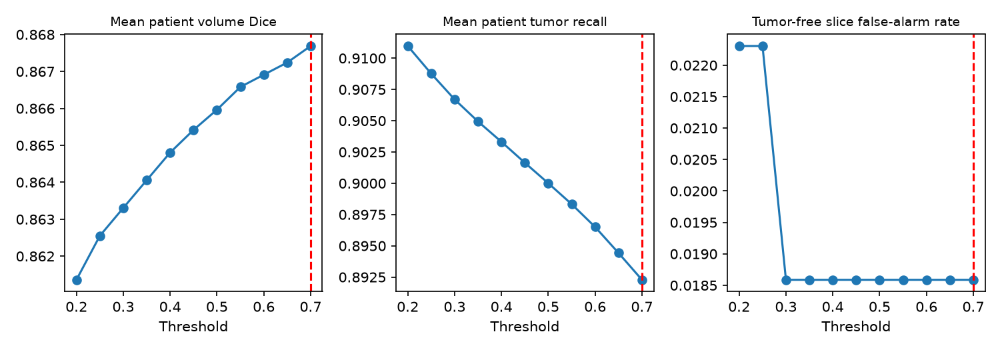

# Original-model threshold selection

The original epoch-21 checkpoint was evaluated on all 14 validation patients at thresholds 0.20 through 0.70 in steps of 0.05. The selection rule maximizes mean patient-volume Dice. Ties within 1e-7 favor the threshold closest to 0.5. Recall and false alarms are measured as tradeoffs. Test patients contribute zero observations to threshold selection.

| Threshold | Mean volume Dice | Median volume Dice | Mean patient recall | Mean patient precision | False alarms | False-alarm rate |
|---|---:|---:|---:|---:|---:|---:|
| 0.20 | 0.8614 | 0.8644 | 91.10% | 82.69% | 6/269 | 2.23% |
| 0.25 | 0.8626 | 0.8675 | 90.88% | 83.09% | 6/269 | 2.23% |
| 0.30 | 0.8633 | 0.8700 | 90.67% | 83.41% | 5/269 | 1.86% |
| 0.35 | 0.8641 | 0.8718 | 90.49% | 83.71% | 5/269 | 1.86% |
| 0.40 | 0.8648 | 0.8736 | 90.33% | 83.99% | 5/269 | 1.86% |
| 0.45 | 0.8654 | 0.8756 | 90.16% | 84.26% | 5/269 | 1.86% |
| 0.50 | 0.8660 | 0.8773 | 90.00% | 84.50% | 5/269 | 1.86% |
| 0.55 | 0.8666 | 0.8788 | 89.83% | 84.78% | 5/269 | 1.86% |
| 0.60 | 0.8669 | 0.8805 | 89.65% | 85.01% | 5/269 | 1.86% |
| 0.65 | 0.8672 | 0.8815 | 89.44% | 85.27% | 5/269 | 1.86% |
| 0.70 | 0.8677 | 0.8828 | 89.23% | 85.56% | 5/269 | 1.86% |

Selected threshold **0.70**. Mean validation Dice changes by +0.0017. Dice improves for 10 patients and worsens for 4.

An exploratory paired patient-bootstrap 95% interval for the mean change is [-0.0013, +0.0043], based on 10,000 resamples with seed 42. This interval omits threshold-selection uncertainty and checkpoint-selection uncertainty. Confirmation on additional independent patients is needed to establish generalization.

Application stores the selected threshold in `checkpoints/inference.json`, bound to the exact checkpoint SHA-256. Model loading reads that file for default evaluation and demo inference. An explicit `Config(prediction_threshold=0.5)` reproduces the original inference setting. A new checkpoint with a different fingerprint falls back to 0.5 and emits a recalibration warning.

Checkpoint SHA-256 `fda957e3a3cb4b78419099ef9987885648fc35176c59e0dd61bde3873610c247`.

## Applied model and refreshed evaluation

Default evaluation, failure analysis, and the restarted Gradio demo now load threshold 0.70 from checkpoint-bound metadata. All nine upload-and-prediction API tests passed at this setting. Explicit threshold-0.5 inference and older checkpoints using the 0.5 fallback were also verified. The refreshed evaluation and failure-analysis notebooks completed successfully.

On the previously evaluated 22 test patients, mean Dice is 0.8139 versus 0.8129 at threshold 0.5. Median Dice is 0.8778 versus 0.8772. False alarms are 18/483 versus 19/483. These follow-up test results are exploratory because the test patients had already been inspected during diagnosis. The observed gain is marginal.

Reference outputs and the earlier evaluation/failure notebooks are archived in `outputs/reference_threshold_0_5/`. The current metrics explicitly record the applied threshold. The threshold 0.70 is the best tested point at the upper boundary of the prespecified grid, so this sweep establishes a choice within that grid.
