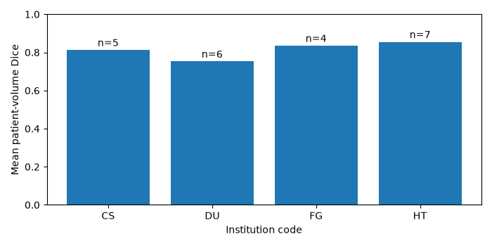

# Results and deployment verification

## Per-seed validation evidence

These values describe the same 14 validation patients. The 22-patient test result belongs to a different cohort and serves a different purpose. Both normalization conditions use corrected worker seeding. The comparison isolates their normalization settings.

| Seed | Whole-volume Dice | Foreground Dice | Whole minus foreground |
|---|---:|---:|---:|
| 42 | 0.8717 | 0.8290 | +0.0427 |
| 43 | 0.8588 | 0.8439 | +0.0149 |
| 44 | 0.8619 | 0.8283 | +0.0336 |

Whole-volume normalization scored higher in all three matched runs. The previously reported uncertainty interval includes zero, so the study supports the choice for these runs while leaving population generalization uncertain.

## Shipped checkpoint

The README, evaluation metrics, and demo identify the original epoch-21 checkpoint trained with the older fixed-transform seeding, at inference threshold 0.70. Its SHA-256 is `fda957e3a3cb4b78419099ef9987885648fc35176c59e0dd61bde3873610c247`. The six corrected-seeding study checkpoints have their own saved identities. The current deployment manifest is `../deployment_manifest.json`.

The original model was evaluated at threshold 0.50 before threshold selection and remeasured at the validation-selected threshold 0.70. This verification adds descriptive errors for that already selected checkpoint and threshold. It provides an audit of the current report, and additional independent patients are needed for confirmatory evaluation.

## Prescribed FLAIR baseline audit

Pillow TIFF loading, float64 threshold arithmetic, and direct volume-level confusion counts reproduce the repository baseline for all 22 patients and 778 test slices. Prediction mismatches are 0. The independent mean Dice is 0.0117, and median Dice is 0.0000.

The raw mean-plus-three-standard-deviations cutoff reaches or exceeds the slice maximum on 47 slices. Another 26 slices have no FLAIR pixels above 10 and produce empty predictions through the specified fallback. 15 patients have zero overlapping predicted and annotated pixels. Pooled annotated-pixel recall is 0.56%. These measurements show that the prescribed rule is a weak comparator on these scans. The prior approximately 1e-12 values arose from adding epsilon to the numerator when overlap was zero. The shared Dice calculation now returns exact zero for nonempty, zero-overlap volumes and one for two empty volumes; denominator stabilization is retained. This numerical clarification changes the displayed near-zero values, with the reported mean still 0.0117.

The baseline formula remains the original raw channel-1 rule with foreground intensities above 10, computed per slice. A stronger comparator would need a separate validation-based development protocol. The mask annotations represent FLAIR abnormality.

Independent patient and slice counts are in `baseline_patient_oracle.csv` and `baseline_slice_oracle.csv`. Baseline comparison images are saved alongside this report.

## Full errors for the shipped model

Test mean volume Dice is 0.8139, median Dice 0.8778. Mean patient precision is 83.35%, and mean patient recall is 82.98%. Pooled pixel precision is 84.46%, and pooled pixel recall is 78.51%. Patient means weight each patient equally; pooled metrics weight their pixel counts.

There are 87,722 false-positive pixels and 130,502 false-negative pixels across the volumes. Of the false-positive pixels, 10,678 occur on tumor-free slices and 77,044 on annotated slices. The model predicts no positive pixels on 20 of 295 annotated slices. Zero true-positive pixels occur on 20 annotated slices. The zero-overlap definition also detects off-target-only predictions when present. False alarms occur on 18/483 tumor-free slices (3.73%). Pixel counts aggregate slices and carry pixel-count units; physical volumes require spacing metadata.

## Institution breakdown

Institution codes come from patient identifiers. These small groups provide descriptive evidence and cannot establish institution-specific causes.

| Institution | Patients | Mean Dice | Mean precision | Mean recall | False alarms | Completely missed annotated slices |
|---|---:|---:|---:|---:|---:|---:|
| CS | 5 | 0.8125 | 75.33% | 91.39% | 8/70 | 3/43 |
| DU | 6 | 0.7527 | 84.04% | 73.30% | 4/162 | 7/80 |
| FG | 4 | 0.8352 | 88.39% | 81.19% | 1/110 | 6/63 |
| HT | 7 | 0.8552 | 85.62% | 86.29% | 5/141 | 4/109 |

## Controller recovery and completion

Controller failed during whole_volume_seed43 after a transient status-file rename lock. Training continued through epoch 30. Controller restart verified existing jobs and registered that completed run before starting foreground_nonzero_seed43. All six training jobs completed on attempt 1.

Every reported study checkpoint has a verified fingerprint, a complete 1-through-30 epoch history, and an attempt-1 completion record. The interrupted component was the progress controller. Training histories, completion records, and selected epochs are preserved in the study directories. Status-file replacement now retries temporary Windows locks. `verification.json` records the checks.

## Files

- `../per_patient_dice.csv` contains complete patient error counts and rates.
- `../per_institution_metrics.csv` contains institution aggregates.
- `../metrics.json` contains summary measures and the shipped checkpoint identity.
- `../deployment_manifest.json` links deployment identity and threshold.
- `../experiments/normalization_multiseed/report.md` documents all six study runs.

Live demo model-ID, epoch, threshold, and upload verification are recorded in `demo_verification.json`. The study institution aggregates are in `../experiments/normalization_multiseed/per_institution_metrics.csv`, with across-seed summaries in `../experiments/normalization_multiseed/per_institution_seed_summary.csv`.
